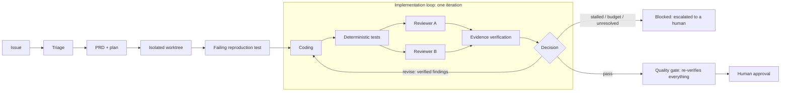
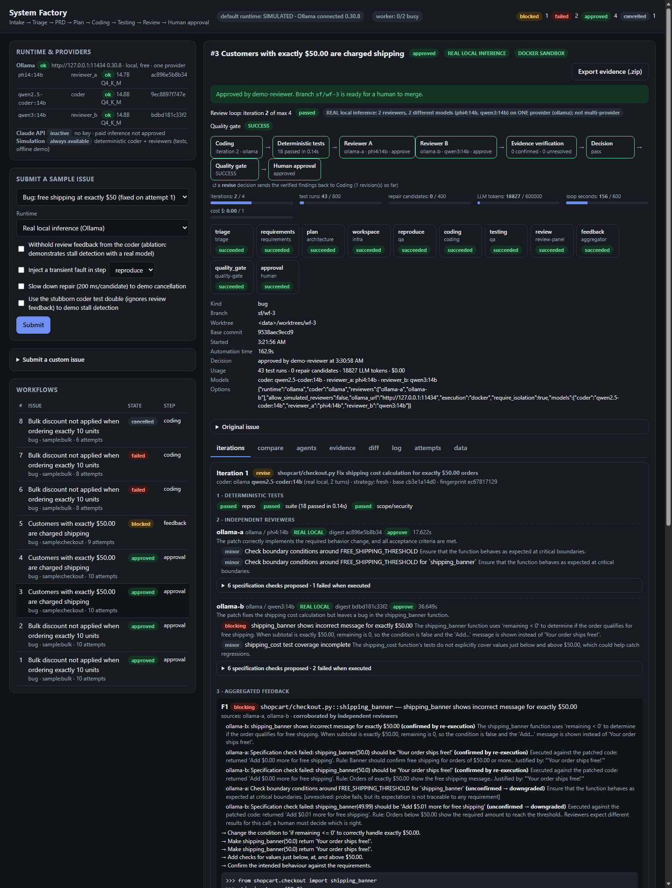
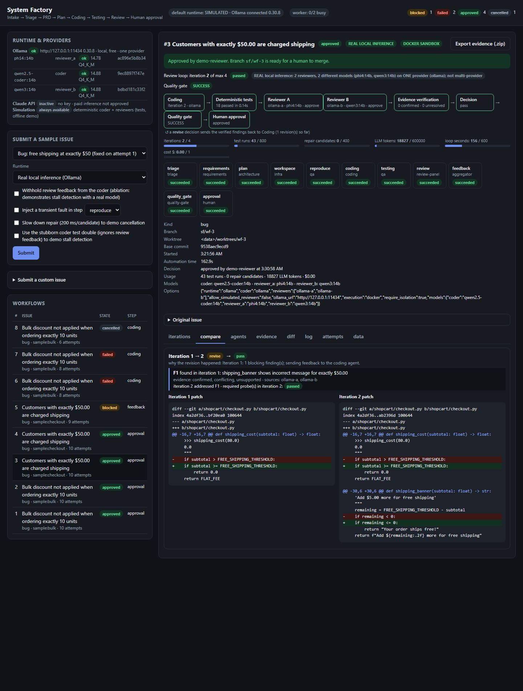
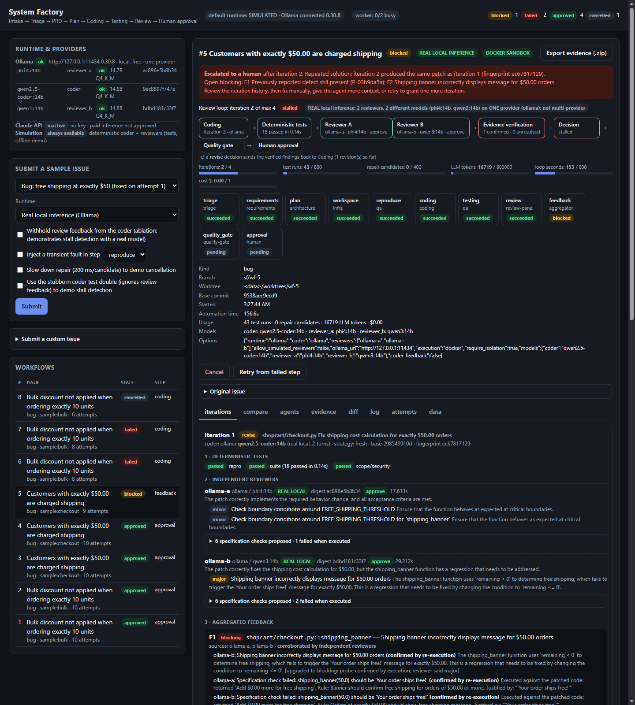
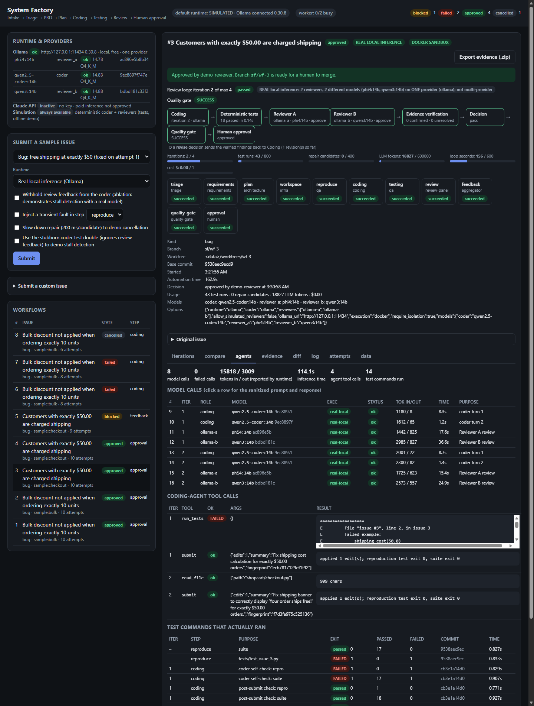
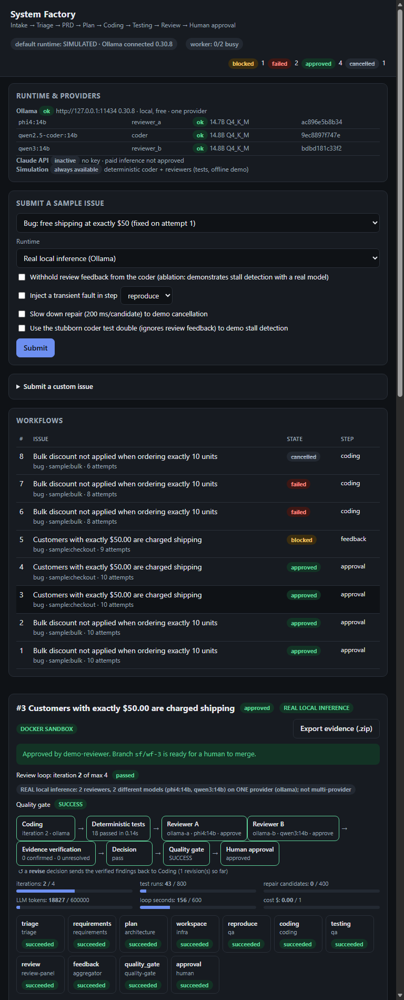

# System Factory

A local orchestrator that takes a software issue from report to a reviewed, tested patch that waits for a human
decision. A **deterministic control plane** runs the pipeline. **Models only work inside steps**, and every claim a
model makes is checked by executing something before it can affect a decision. System Factory never merges, pushes
or deploys.



## The problem

A patch that passes the tests can still be wrong, and a model reviewer's verdict is not evidence. In this
project's own measurements, the best local reviewer model (phi4:14b) approved all 9 defective patches by its own
verdict, and the other models did little better. The same reviewers' **executable checks**, run in a sandbox
and traced to the requirements, caught 6 of the 9 defects without blocking a correct change
([evaluation](#measured-reviewer-evaluation)). System Factory is built
around that difference.

## How the loop works

1. **QA turns the issue's example into a test** and proves that it **fails** on the current code before coding starts.
2. **Coding:** the deterministic repair search or a tool-using LLM agent edits only the planned source files in its
   own git worktree.
3. **Deterministic tests:** the reproduction test, the full suite, every probe from earlier iterations, and scope and
   security scans.
4. **Two reviewers** get identical, deep-copied inputs (diff, requirements, test evidence, history). Neither sees the
   other's output. Each must propose **executable checks**: a function call and its expected result.
5. **Evidence verification** (control plane, not a model) executes every check and classifies each claim:

   | State | Meaning | Effect |
   |---|---|---|
   | confirmed | the check failed, and its expected value is grounded in the issue, acceptance criteria or docs (or two reviewers independently expect the same) | blocking: sent back to coding as feedback |
   | unsupported | the check failed, but the expectation is not traceable to any requirement | unresolved: escalate |
   | conflicting | reviewers expect different results for the same call | unresolved: escalate |
   | unverified | a claim with no runnable check, or a probe that is itself broken | downgraded |
   | invalid / passed | the check was rejected by validation, or executed and passed | recorded only |

6. **Decision** (`loop.assess_progress`): *revise* with the verified findings, *pass*, or stop: a repeated patch
   fingerprint, the same failure signature, no progress, unresolved evidence, or an exhausted budget. A stop sets
   the workflow to **blocked** with an escalation record; it never approves.
7. **Quality gate:** re-verifies every acceptance criterion and every required probe. It also checks that at least two
   reviews inspected the change, that no evidence is unresolved, and that the reviewed commit is the final HEAD of a
   clean worktree. **Approval is refused** without a gate SUCCESS.

## Control plane vs model roles

| Owned by the deterministic control plane | Done by a role (model or deterministic) inside a step |
|---|---|
| step order, retries, iterations, budgets, cancellation, crash recovery | writing a patch (allow-listed files only, its own worktree) |
| executing tests, probes and checks (in the sandbox) | proposing review findings and executable checks |
| evidence classification, decisions, stall detection | drafting PRD, plan and support answers |
| quality gate, approval guard, audit log, evidence export | — |

A model never chooses the next step, never runs a shell, and never judges its own evidence.

## Real vs simulated

| Runtime | Coder | Reviewers | Execution backend | Use |
|---|---|---|---|---|
| `simulated` (default) | deterministic search-based repair | two deterministic reviewers (spec examples, diff heuristics) | `local` process | tests, CI, offline demo |
| `ollama` | `qwen2.5-coder:14b` tool-using agent | Reviewer A `phi4:14b`, Reviewer B `qwen3:14b` | `docker` sandbox, **required** (fails closed) | real local inference |

All three models run on **one provider** (a local Ollama server). Different models are not different providers,
and the dashboard and evidence say so. Every model call, including a failed one, is recorded with model, digest,
the token counts Ollama reported, timing, and the sanitized prompt and response. The real runtime never silently
falls back to a simulation. Claude and external-command reviewer adapters exist but are disabled without explicit
keys and approval.

## Screenshots

Real captures of the dashboard serving recorded workflows from the final-code real run (`examples/evidence/real/run-2-7f6a5b2`):



| | |
|---|---|
|  |  |
|  |  |

Deterministic-runtime captures: [01](docs/screenshots/01-iterations-review-loop.png), [02](docs/screenshots/02-stall-escalation.png),
[03](docs/screenshots/03-agents-test-evidence.png).

## One-command demo

```powershell
git clone https://github.com/Whitesun123/system-factory.git; cd system-factory; .\scripts\setup.ps1; .\scripts\start.ps1
```

Then open http://127.0.0.1:8765, pick a sample and press **Submit**. The deterministic runtime needs no GPU,
network or model. For a fully scripted, offline run of all samples on the command line:

```powershell
python -m systemfactory demo
```

[DEMO.md](DEMO.md) is a five-minute walkthrough; [PRESENTATION.md](PRESENTATION.md) has explanation notes.

## Real local inference (optional)

Requirements: Ollama, the three models (about 25 GB) and Docker for the sandbox.

```powershell
.\scripts\pull_models.ps1
```

```powershell
.\scripts\build_sandbox_image.ps1
```

```powershell
python scripts\check_models.py
```

```powershell
python -m systemfactory submit --sample checkout --runtime ollama
```

```powershell
python -m systemfactory run
```

`check_models.py` reads the model list only; it never loads a model. If Docker or the sandbox image is missing, a
real-runtime workflow is **blocked before anything executes**. The scripted real scenarios (`scripts/real_demo.py`)
check each result against an oracle the agents never see.

### Real scenarios (measured)

`scripts/real_demo.py --repeat 2` ran twice from clean clones: once on `c8026e0` and once on the final pipeline code
`7f6a5b2` (after the independent-review fixes). Coder `qwen2.5-coder:14b`, reviewers `phi4:14b` and `qwen3:14b`, one
provider, every test and check in the Docker sandbox. Results were checked against hidden oracles.

| Scenario | What it tests | Result (both runs) |
|---|---|---|
| A real fix (bulk discount), ×2 per run | real coder + two real reviewers | 4/4 passed in 1 iteration, gate SUCCESS, oracle satisfied; 68–79 s |
| **B revision after review** (free shipping), ×2 per run | the report names one defect; a related one must be found by review | **4/4: revise → pass.** Iteration 1 fixed `shipping_cost` but left `shipping_banner(50.0)` wrong; both reviewers independently proposed that check, it failed in the sandbox and was confirmed against the docstring; iteration 2 fixed it. Oracle satisfied; 161–184 s |
| C feedback withheld (ablation) | stall detection with a real coder | 2/2 **stalled**: the same patch twice (fingerprint `ec67817129`), escalated, not approved |
| D1 Ollama unreachable | provider failure | 2/2 failed after 3 attempts; 3 failed model calls recorded; no simulated substitute |
| D2 model timeout (1 s) | provider timeout | 2/2 failed after 3 attempts |
| D3 cancel during real coding | cancellation | 2/2 cancelled |
| E approval guard | approve every workflow | only the 4 gate-SUCCESS workflows per run could be approved; the others were refused; the demo `main` branch was unchanged |

These are **repeated observations at temperature 0 with fixed seeds**, on two small synthetic bugs. That shows the
behaviour is reproducible under fixed sampling. It is not an automation rate. Evidence packages, including every
prompt and response (sanitized): [examples/evidence/real/](examples/evidence/real/).

## Execution sandbox

Untrusted code (target-repository tests, model-written patches and checks) runs through one choke point,
`StepContext.run_python`, on a pluggable backend ([execution.py](systemfactory/execution.py)). The `docker`
backend starts a fresh container per command with: no network, a read-only root, the worktree and probes mounted
read-only, a tmpfs `/tmp`, all capabilities dropped, `no-new-privileges`, uid 65534, and PID, memory and CPU limits.
The container is always force-removed. The image is pinned by digest and its packages by hash. Adversarial tests use
harmless synthetic payloads ([tests/test_docker_sandbox.py](tests/test_docker_sandbox.py)). Trust policy and limits:
[sandbox/README.md](sandbox/README.md).

## Measured reviewer evaluation

23 labelled cases (11 defective, 12 correct) over 12 small code bases. Every case is a valid bug fix whose
reproduction test passes, so the defects are the ones tests miss. Results are from real inference: 30.4 minutes of a
30-minute budget, one provider, checks executed in the Docker sandbox. On the 18 cases that every configuration ran:

| Decision source | defects caught (of 9) | false approvals | false blocks | correct changes approved (of 9) | escalated (of 18) |
|---|---|---|---|---|---|
| deterministic reviewers | 0 | 9 | 0 | 9 | 0 |
| phi4:14b, raw verdict | 0 | 9 | 0 | 9 | 0 |
| phi4:14b alone, evidence pipeline | 6 | 3 | 0 | 8 | 1 |
| **phi4 + qwen3:14b panel, evidence pipeline (selected)** | **6** | **1** | **0** | **8** | **2** |
| phi4 + gemma3:12b panel, evidence pipeline | 7 | 1 | 1 | 5 | 4 |
| phi4 + mistral-nemo:12b panel, evidence pipeline | 6 | 1 | 0 | 1 | 10 |
| phi4 + phi4 (same model, two prompts) | 6 | 2 | 0 | 7 | 3 |

Full tables, per-case results, latency, tokens, model digests and the 22 (case, model) pairs that were **not
executed**: [evaluation/results/REPORT.md](evaluation/results/REPORT.md). The selected panel had one reviewer error
(qwen3 returned an empty reply after spending its output on thinking tokens), which counts as neither a catch nor an
approval. The panels differ by one or two cases, which is within noise on 18 cases. **The evaluation also exposed
three defects in the evidence pipeline itself, which were fixed on this same dataset, so these post-fix numbers are
optimistic; there is no held-out set** (see the case study and D23).

## Case study: from "reviewer says OK" to executed, grounded evidence

1. **Problem.** An automated fix must not ship because it passes the tests. The planted `bulk` bug has two
   boundaries; the issue reports only one.
2. **Initial design (Milestone 3).** Review once, after coding, and retry coding blindly on failure. Tests passed
   the incomplete fix.
3. **First revision (Milestone 4).** Review moved *inside* the loop. A failing reviewer probe became feedback for
   the next iteration, and repeated patches were detected by fingerprint.
4. **Discovered flaw (Milestone 5, real models).** A real LLM reviewer *approved* an incomplete fix. Another invented
   a blocker. A verdict is not evidence.
5. **Revised architecture (Milestones 5–6).** Reviewers must emit executable checks. The control plane runs them in a
   container and confirms a failure only if its expected value traces to a requirement or is corroborated.
   Untraceable or conflicting evidence escalates instead of blocking or approving. The gate re-verifies the final
   commit.
6. **Evidence, including against ourselves.** The labelled evaluation measured the difference above. It also
   exposed three defects in our own evidence pipeline. Different models "confirmed" a defect in a *correct* change
   because an expected exception was compared as a string. A mis-escaped backslash made a model's check test a
   different input. And valid checks were discarded or not counted as an inspection because a model wrote the
   function name in the prompt's inventory format, which escalated almost every correct change. The first real run
   then showed exactly that escalation. Each defect got a regression test, and the cached reviews were re-scored
   with no new inference (D23).
7. **Outcome.** The selected panel (phi4 + qwen3) caught 6 of 9 defects, with 1 false approval and no false blocks,
   and approved 8 of 9 correct changes. The remaining cost is honest uncertainty: 2 of 18 cases escalated to a
   human, and the numbers come from the dataset the fixes were found on.

## Evidence

Every workflow is persisted in SQLite: steps, attempts, iterations, reviews, model calls, tool calls, test runs and
the audit log. `python -m systemfactory export ID` writes a sanitized package (secrets redacted, local paths
rewritten). Each manifest records the System Factory revision **at submission** and, separately, at export.
`tests/test_evidence_integrity.py` checks every committed package: both revisions must exist in history and be
clean. Packages: [examples/evidence/](examples/evidence/).

## Tests and CI

```powershell
.\scripts\test.ps1
```

The suite is deterministic: no Ollama, GPU or network. Provider failures are tested against a closed local port.
GitHub Actions runs on **Windows and Ubuntu**: ruff, mypy, the full suite under coverage with a minimum of 85% on the
control-plane modules (95% measured locally), and, on Linux, the Docker sandbox tests against the real image.
Real-model evaluation runs only from a separate, manually dispatched workflow for a self-hosted GPU runner. It uses
no secrets. No such runner is registered; because the repository is public, one must only be added in a runner
group restricted to that workflow on `main`, with approval required for outside contributors (the workflow file
alone cannot keep pull-request code off a self-hosted runner).

Developer loop: `pip install -r requirements.txt -r requirements-dev.txt -c constraints.txt`, then
`python -m ruff check .`, `python -m mypy systemfactory evaluation`, `.\scripts\test.ps1`.

## Configuration

All settings are environment variables; [.env.example](.env.example) lists them.

| Variable | Default | Meaning |
|---|---|---|
| `SF_RUNTIME` | `simulated` | default runtime for new workflows |
| `SF_DATA_DIR` | `./data` | SQLite DB, generated demo repository, worktrees, evidence |
| `SF_EXECUTION` | `local` | execution backend for the simulated runtime (the `ollama` runtime always uses `docker`) |
| `SF_SANDBOX_IMAGE` | `systemfactory-sandbox:1` | sandbox image |
| `SF_OLLAMA_URL` | `http://127.0.0.1:11434` | Ollama server |
| `SF_CODER_MODEL` / `SF_REVIEWER_A_MODEL` / `SF_REVIEWER_B_MODEL` | `qwen2.5-coder:14b` / `phi4:14b` / `qwen3:14b` | models |
| `SF_OLLAMA_TIMEOUT` | `300` | seconds per model call |

Per-workflow budgets (iterations, loop time, tokens, cost, test runs, repair candidates) are in
`Settings.default_budget` ([config.py](systemfactory/config.py)).

## Design decisions

[DECISIONS.md](DECISIONS.md) records each decision as problem, solution, tradeoff and evidence. The ones that shaped
the current system: D13 (review inside the loop), D16 (stall detection escalates), D18 (executable checks), D19 (one
provider is one provider), D21 (fail-closed Docker sandbox), D22 (evidence states and grounding) and D23 (measured
reviewer selection). Architecture: [ARCHITECTURE.md](ARCHITECTURE.md).

## Limitations

- **Small evaluation.** 23 cases, 18 comparable across models, all synthetic and small. The panels differ by one case.
- **Evaluation on the tuning set.** The three pipeline fixes were found on the evaluation dataset; the post-fix
  numbers are optimistic. Lexical grounding can also confirm a wrong expectation when a requirement quotes an error
  message but not its condition.
- **Slow, occasionally empty Reviewer B.** qwen3:14b averaged 43 s per review and returned 1 empty reply in 19.
- **One provider.** All models run on local Ollama. No second provider has been evaluated.
- **Container, not VM.** The sandbox shares the host kernel. Git runs on the host (read-only use of target files).
  Dependency installation from a target repository is not supported.
- **Bug fixes only.** The coding step implements fixes that have a failing reproduction test; features are handed to
  a human.
- **Local, single-user.** No authentication; the API binds to 127.0.0.1 and rejects cross-site and rebinding
  requests.

## Roadmap

- A larger, externally sourced issue set and repeated runs, to measure an automation rate.
- Semantic (not only lexical) requirement grounding, to reduce escalations.
- Run qwen3 with thinking disabled and re-measure it on a held-out case set before relying on the change.
- A second provider, behind the existing adapter interface, with explicit budget approval.
- Dependency installation inside the sandbox, under a separate trust policy.

## Repository layout

```
systemfactory/   orchestrator, statemachine, store, roles, loop (evidence + decisions), execution (backends),
                 repair (deterministic coder), coders (LLM agent), reviewers, llm, evidence, sandbox, api, cli, static/
evaluation/      labelled reviewer evaluation: dataset, labels, harness, runner, results/
sandbox/         Dockerfile, hash-pinned requirements, trust policy
demo/            intentionally buggy demo library (copied into data/ as its own git repository)
scripts/         setup, start, test, build_sandbox_image, pull_models, check_models, real_demo
tests/           deterministic unit, scenario, sandbox and evidence-integrity tests
examples/        sanitized evidence packages
```

Status documents: [MILESTONE6_STATUS.md](MILESTONE6_STATUS.md) (current), [MILESTONE5_STATUS.md](MILESTONE5_STATUS.md).

## License

MIT. See [LICENSE](LICENSE).
